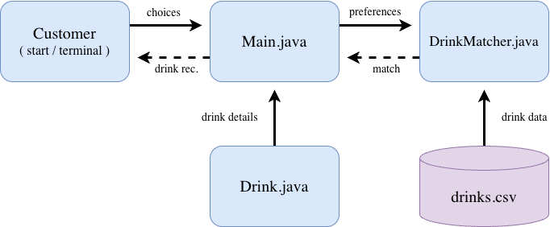

# DutchBrosDrinkMatchmaker
**Project Goal**

I work at Dutch Bros, and one thing I've noticed is that customers, especially new ones, have a hard time deciding what to get because we have SO many options. I want to make a little drink matchmaker program that walks customers through a few choices and helps them figure out what to order without getting overwhelmed.

**MVP (Version 1.0)**

-Let customers pick their drink base, like coffee, Rebel, lemonade, soda, tea, etc.

-Show them different flavor options depending on what base they picked.

-Let them choose 2-3 flavors they like.

-Recommend a drink based on their choices.

-Let them pick their drink size and whether they want it hot, iced, or blended, depending on the drink.

**Future Plans (Version 2.0+)**

-Give customers a few different drink recommendations instead of just one.

-Add seasonal drinks so the recommendations change with the menu.

-Let customers add toppings to their drinks.

-Give customers a way to save drinks they really like for next time.

**Tech Stack**

-Java: The main language I'll use to make the program.

-IntelliJ IDEA: Where I'll write and test my code.

-Scanner and ArrayList: To get customer choices and keep track of drinks and flavors.

-Random: In case multiple drinks match someone's choices equally.

-CSV file: To keep the drink names, flavors, and categories organized.

-Git and GitHub: To save my work and keep track of changes as I build everything.

I won't need any outside APIs since I'll be using my own knowledge from working at Dutch Bros, along with the drink menu.

**System Diagram**

This is the flowchart I made for my Dutch Bros Drink Matchmaker. It shows how customers go from picking their drink base and flavors to getting a recommendation and customizing their final drink.

